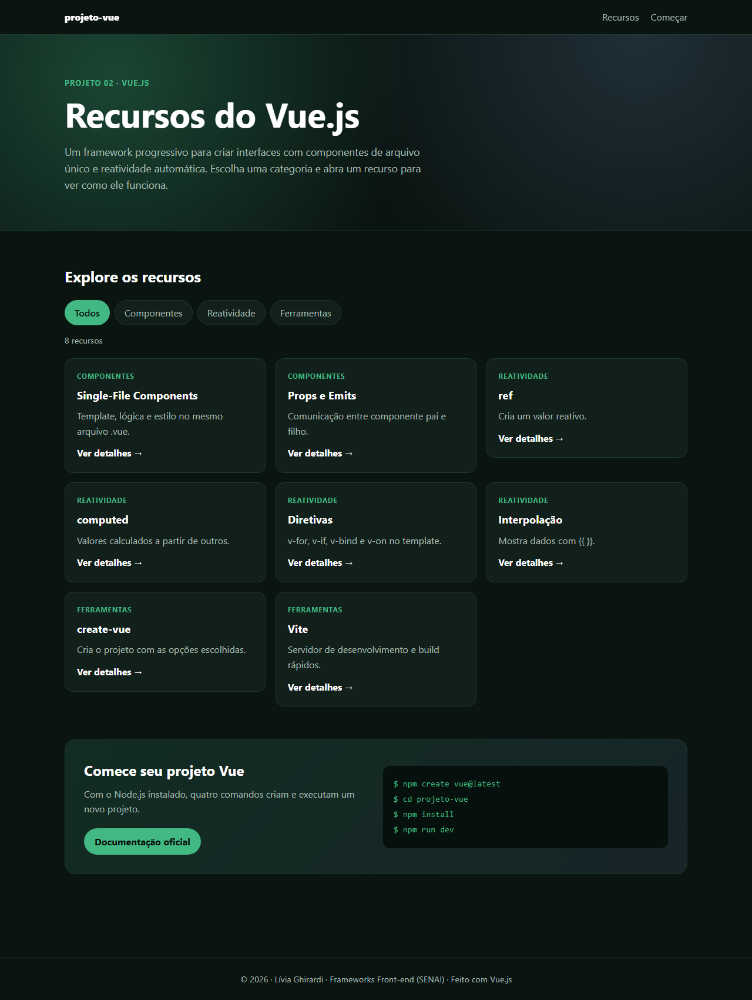
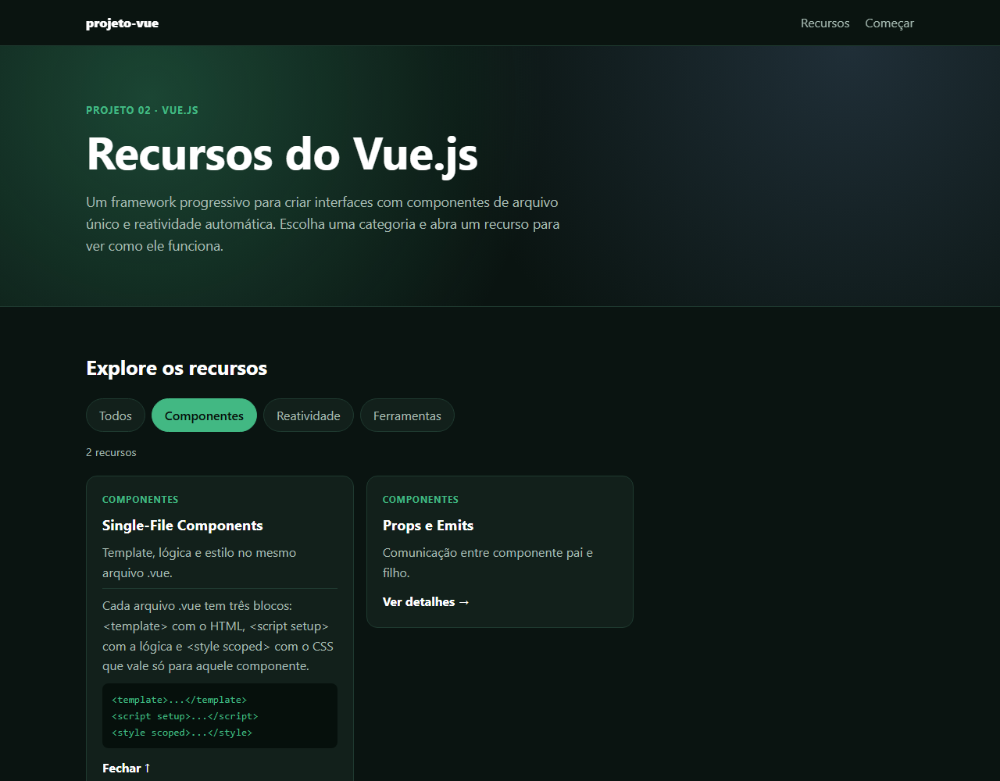

# Recursos do Vue.js — Projeto 02

Projeto Vue da atividade **Projetos com Frameworks Front-end (Aula 03)** da disciplina **Frameworks Front-end (SENAI)**.

A página apresenta os principais recursos do Vue.js. O usuário filtra os recursos por categoria e abre cada card para ver uma explicação e um exemplo de código.

- **Aplicação online:** https://vue-gold-alpha.vercel.app/

## Prints





## Componentes

| Componente | Função |
|------------|--------|
| `App.vue` | Componente raiz que monta a página |
| `AppHeader.vue` | Barra de navegação fixa no topo |
| `HeroSection.vue` | Título e subtítulo, recebidos do `App` por `defineProps` |
| `ListaRecursos.vue` | Filtro por categoria e lista de recursos (estado com `ref` e `computed`) |
| `RecursoCard.vue` | Card de cada recurso; avisa a lista com `defineEmits` quando é aberto |
| `ComecarSection.vue` | Chamada para começar um projeto, com os comandos do `create-vue` |
| `AppFooter.vue` | Rodapé |

Os dados ficam em `src/data/recursos.js`.

## Conceitos utilizados

- **Single-File Components** com `<template>`, `<script setup>` e `<style scoped>`
- **Props e Emits** para a comunicação entre componentes pai e filho
- **Reatividade** com `ref` e `computed`
- **Diretivas** `v-for`, `v-if`, `:class` (v-bind) e `@click` (v-on)
- **Interpolação** com `{{ }}`

## Como executar

```bash
npm install
npm run dev
```

Para gerar a versão de produção: `npm run build`.
